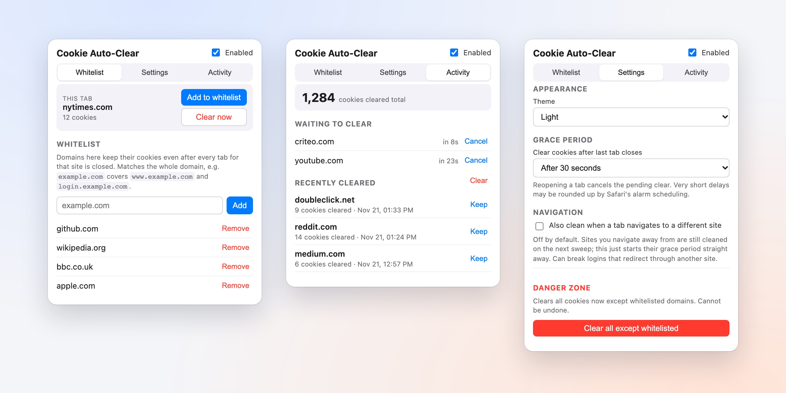

# Cookie Auto-Clear

A Safari Web Extension that deletes a site's cookies once you've closed every
tab for it, unless the site is on your whitelist. It's a Safari take on
[Cookie AutoDelete](https://github.com/Cookie-AutoDelete/Cookie-AutoDelete).

<picture>
  <source media="(prefers-color-scheme: dark)" srcset="docs/screenshots/popup-dark.jpg">
  
</picture>

## Features

- **Automatic cleanup**: when you close a site's last tab, its cookies are
  cleared after a grace period (30 seconds by default). Reopening the site
  during that time cancels it.
- **Cleans everything nothing is using**: each cleanup removes cookies for
  *every* site with no open tab, so trackers embedded in other pages, and
  sites a tab simply navigated away from, get cleared too.
- **Whitelist**: add sites from the popup, from the "This tab" card, from
  the Activity log, or by right-clicking a page or link. `example.com` covers
  `www.example.com`, `login.example.com` and so on.
- **Optional cleanup on navigation**: also start the grace period when a tab
  leaves a site (off by default, since it can break logins that redirect
  through another site).
- **Cleanup at startup**: sites still open when Safari quit are cleaned the
  next time it launches.
- **Popup**:
  - cookie count for the current site, with "Clear now"
  - sites waiting out their grace period, each with a countdown and a Cancel
    button
  - a log of recent cleanups and a running total
  - "Clear all except whitelisted"
  - on/off switch, with an "OFF" badge on the toolbar icon while it's off
  - light/dark theme

### What it doesn't clear

Only cookies. Safari doesn't give extensions an API for deleting a site's
localStorage, IndexedDB, Cache Storage or service workers (there is no
`browsingData` API in Safari). Safari's own tracking prevention deletes that
kind of data for sites you haven't used in 7 days, and you can clear it
manually under Safari Settings → Privacy → Manage Website Data.

## Layout

```
extension/            The web extension itself
  manifest.json       Manifest V3 config
  background.js       Tab tracking and cookie cleanup (service worker)
  popup.html/.js/.css Toolbar popup
  icons/              Toolbar and extension icons
safari-app/           Xcode project wrapping the extension in a macOS/iOS app
tools/make-icons.swift  Regenerates every icon: swift tools/make-icons.swift <outdir>
```

The Xcode project references the files in `extension/` directly rather than
copying them, so edit them in place and rebuild.

## How it works

- **Tab tracking**: `background.js` keeps a map of tab ID → site in
  `browser.storage.local`, updated as tabs open, navigate and close. It's
  stored rather than kept in memory because Safari can stop the service
  worker between events. The map is rebuilt from the open tabs at startup and
  on install. All changes to it go through a queue, so two tab events firing
  together can't overwrite each other.
- **Grace period**: when a site loses its last tab, an alarm named after the
  site is scheduled. Alarms are used instead of `setTimeout` because a timer
  dies when the service worker is stopped. Opening the site again clears the
  alarm. Very short delays may be rounded up by Safari's alarm scheduling.
- **Sweep**: when an alarm fires, the extension goes through every cookie in
  every cookie store and removes those belonging to a site that has no open
  tab, isn't whitelisted, and isn't still waiting out its own grace period.
  It sweeps the same way at browser startup and when you switch the extension
  back on. With the grace period set to "Immediately", the sweep runs as soon
  as the tab closes.
- **Navigation**: by default, a tab moving to another site doesn't start a
  grace period for the site it left. Logins that bounce through an
  identity provider or payment page would otherwise lose the cookies they just
  set. The site left behind is still cleaned by the next sweep. The
  "Also clean when a tab navigates to a different site" setting starts its
  grace period straight away instead.
- **Site matching**: everything is grouped by registrable domain, so
  `example.com` and `www.example.com` count as one site. This uses a short
  list of two-part country suffixes (`co.uk`, `com.au` and similar), not the
  full Public Suffix List, so an unusual suffix could be split wrongly. The
  function is duplicated in `background.js` and `popup.js`; keep the two in
  sync.

## Requirements

- macOS with Xcode installed
- Safari 16.4 or later
- A free Apple Developer account (personal team) is enough to sign it for
  your own Mac
- To run an unsigned build: Safari → Develop menu → Allow Unsigned
  Extensions. If there's no Develop menu, turn it on under Safari Settings →
  Advanced.

## Build and run

1. Open `safari-app/Cookie Auto-Clear/Cookie Auto-Clear.xcodeproj`.
2. Choose the **Cookie Auto-Clear (macOS)** scheme and **My Mac** as the
   destination.
3. Under Signing & Capabilities, pick your personal team for both the app
   target and the extension target.
4. Run (⌘R). The host app opens and offers to take you to Safari's
   extension settings.
5. Turn on Cookie Auto-Clear in Safari Settings → Extensions, and allow it
   on all websites. It can only clear cookies for sites it has permission for.
6. If Safari won't load it, check that Develop → Allow Unsigned Extensions
   is on. That setting resets when Safari quits.

To regenerate the Xcode project from scratch:

```bash
xcrun safari-web-extension-converter extension --project-location ./safari-app --app-name "Cookie Auto-Clear"
```

## Testing

1. Open a tab on a site that sets cookies. The popup's "This tab" card
   shows its cookie count.
2. Close every tab for that site. It appears under Activity → "Waiting to
   clear" with a countdown.
3. After the countdown, it moves to "Recently cleared". You can confirm in
   Safari Settings → Privacy → Manage Website Data.
4. Whitelist the site and repeat: its cookies should survive.
5. Open two tabs on the same site and close one: nothing should be
   scheduled.
6. Close a site's tab and reopen it before the countdown ends: the pending
   clear should disappear.

Debug output goes to the extension's background console: Safari → Develop →
Web Extension Background Content → Cookie Auto-Clear.

## Limitations

- Cookies only (see "What it doesn't clear" above).
- Private windows: Safari only runs extensions there if you allow it in the
  extension's settings. Without that, private tabs aren't tracked.
- Like Cookie AutoDelete, a sweep can remove cookies for a third-party
  service that an open tab still uses inside an embedded frame (a
  comments widget or embedded login, for example). Whitelist the service if
  that's a problem.
- The startup sweep runs once the open tabs have been read. If Safari
  hasn't yet reported a restored tab's address at that point, that site's
  cookies could be cleared.

## License

MIT. See [LICENSE](LICENSE).
